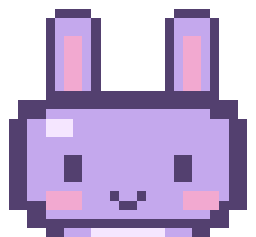
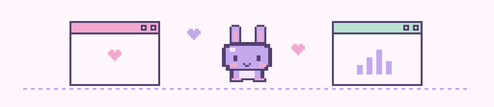
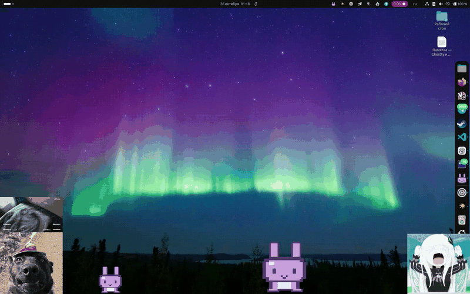
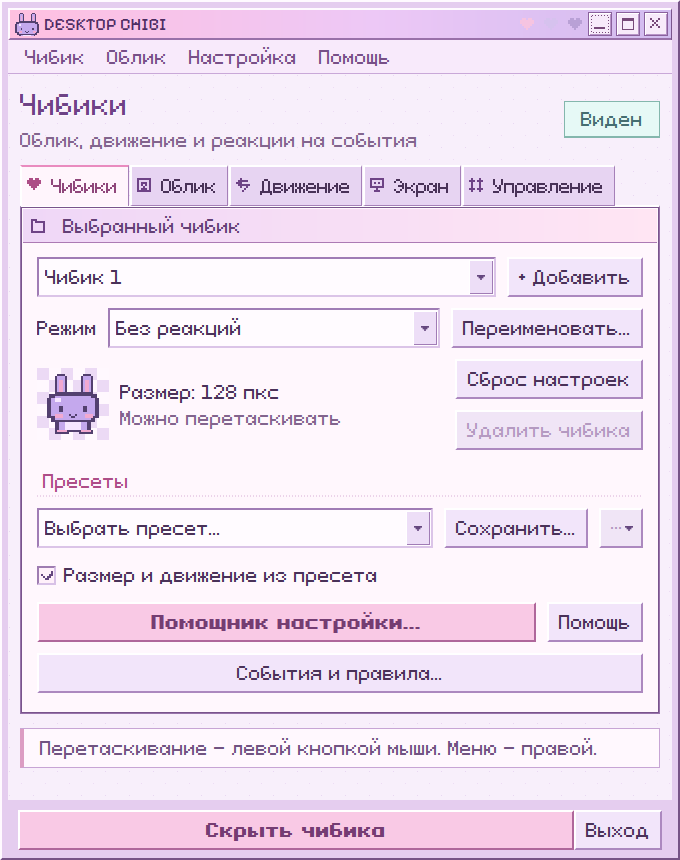
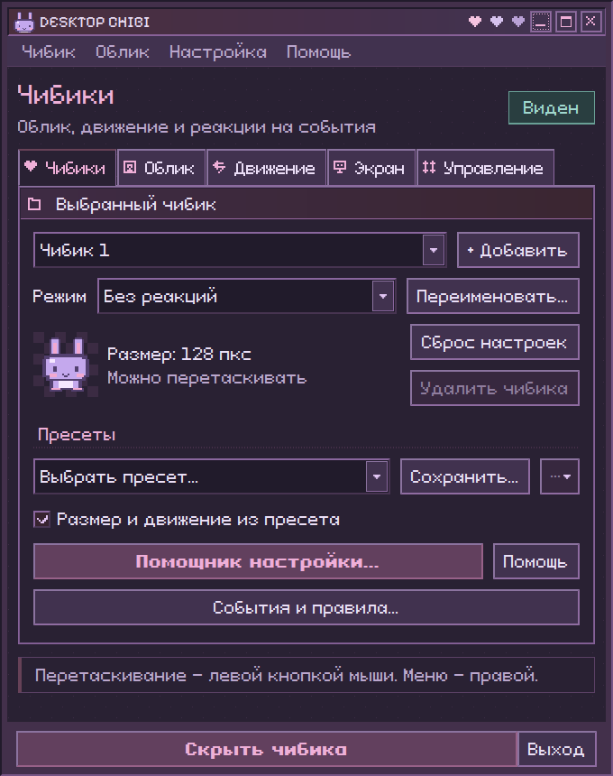
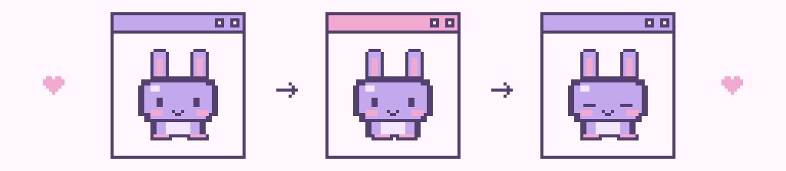
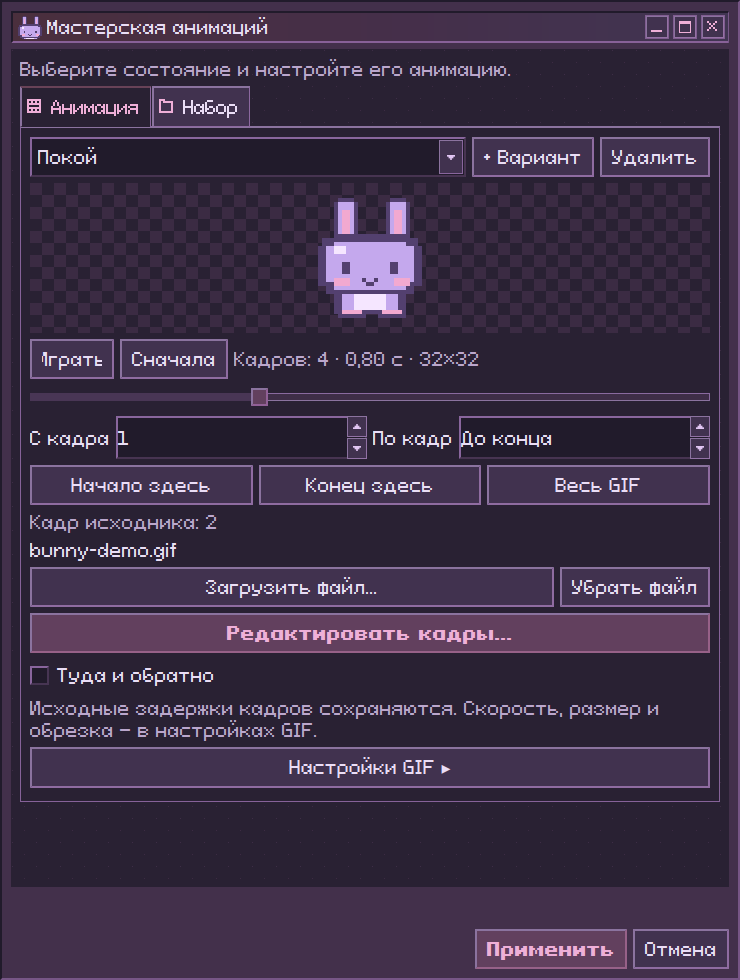

<div align="center">
  
  <h1>Desktop Chibi</h1>
  <p><b>Маленький сосед по рабочему столу.</b><br>Гуляет, реагирует на события, напоминает о перерыве и носит твои GIF.</p>
  <p>Windows · Ubuntu · Qt 6 · пиксельный интерфейс</p>
  <p><a href="#запуск">Запуск</a> · <a href="#что-умеет">Возможности</a> · <a href="#свой-gif">Свой GIF</a> · <a href="docs/guide.md">Руководство</a></p>
</div>



> **♡ Твой персонаж, твои правила.** Облик можно нарисовать с нуля или принести из другого редактора. Источники событий подключаются отдельно, а обычному декоративному чибику они вообще не нужны.

## Вживую на рабочем столе

Свои GIF, несколько чибиков и маленький заяц — прямо поверх рабочего стола.



<p align="center"><sub>Запись работы приложения · 35 секунд · <a href="docs/images/desktop-demo.gif">открыть GIF отдельно</a></sub></p>

## Что умеет

| Раздел | Что внутри |
| :--- | :--- |
| **Чибики и пресеты** | До 32 независимых персонажей. Сохранение обликов и быстрая смена через трей. |
| **Мастерская** | GIF и спрайт-листы, обрезка, скорость, обратное проигрывание и «туда и обратно». |
| **Редактор кадров** | Холст до 512×512, слои, общие детали, заливка, история и сохранение ритма GIF. |
| **События** | Уведомления приложений, звук плеера, завершение команды и речь друга в Vesktop. |
| **Напоминания** | Обратный отсчёт, периодический перерыв и цикл «работа / отдых». Свои звуки у правил. |
| **Рабочий стол** | Перетаскивание, гравитация, область прогулки, порядок наложения чибиков, оверлей и горячие клавиши для всех. |

## Запуск

Готовые сборки находятся в [GitHub Releases](https://github.com/Magirchik/desktop-chibi/releases):

- **Windows x64:** распакуй ZIP и запусти `desktop-chibi.exe`. Папка `_internal` должна оставаться рядом.
- **Ubuntu 22.04+ amd64:** установи `.deb` через `sudo apt install ./desktop-chibi-v0.1.0-ubuntu-amd64.deb`. Переносной вариант — `.tar.gz`.

Python в готовые сборки уже включён. [Различия платформ и выпуск новой версии](docs/releases.md).

<details>
<summary>Запуск из исходников · Python 3.10+</summary>

```sh
git clone https://github.com/Magirchik/desktop-chibi.git
cd desktop-chibi
python3 -m venv .venv
.venv/bin/python -m pip install -r requirements.txt
.venv/bin/python -m desktop_chibi
```

Чтобы запускать из меню приложений и закрепить значок на панели:

```sh
.venv/bin/python scripts/install_desktop.py
```

Найди **Desktop Chibi** в меню. После перемещения папки проекта запусти установщик ярлыка ещё раз.

</details>

<details>
<summary>Запуск на Windows</summary>

```powershell
python -m venv .venv
.venv\Scripts\python -m pip install -r requirements.txt
.venv\Scripts\python -m desktop_chibi
```

В Windows работают редактор, персонажи, темы, напоминания, локальные события, нативные глобальные хоткеи, правила активных приложений и WAV-звуки. Системные уведомления Linux, PipeWire и плагин Vesktop остаются Linux-интеграциями.

</details>

## Первый чибик

1. Нажми **«Помощник настройки…»** и выбери сценарий — от простой прогулки до напоминаний.
2. Настрой выбранного чибика или добавь нового. Новые персонажи получают чистые настройки.
3. Загрузи облик на вкладке **«Облик»**. Сохрани удачный вариант в **«Пресеты»**.

Левой кнопкой мыши можно перетаскивать чибика, правой — открыть его меню. Двойной щелчок открывает настройки. Если включён пропуск кликов, переключи его во вкладке **«Управление»** или горячей клавишей.

## Темы

**Настройка → Настройки приложения…** — выбрать тему. Она применяется сразу во всех окнах и сохраняется после перезапуска.

| Light · светлая | Dark · тёмная |
| :---: | :---: |
|  |  |

Есть и синяя ночная **Midnight**. Темы меняют интерфейс, сохраняя цвета персонажей и рисунков.

## Свой GIF



Открой **«Облик → Мастерская анимаций…»** и перетащи файл в окно.
Можно начать с [примера GIF со встроенным зайчиком](docs/images/bunny-demo.gif).

1. Выбери состояние: покой, ходьба, уведомление или другое.
2. Выбери первый и последний кадр числами либо отметь их кнопками **«Начало здесь» / «Конец здесь»** под предпросмотром.
3. При желании настрой скорость, обратный порядок или **«Туда и обратно»**.
4. Для рисования нажми **«Редактировать кадры…»**. Большой GIF предложит выбрать фрагмент и размер до **512×512**.
5. Закончив рисовать, выбери **«Размер для чибика»**. **«Авто»** уменьшит тяжёлую анимацию, а проект слоёв сохранит полное разрешение.

Исходный GIF не перезаписывается. Задержки кадров сохраняются при редактировании; изменение FPS вручную задаёт равномерную скорость. Набор можно экспортировать вместе с рисунками и проектами слоёв.



## Память и нагрузка

512×512 требует в четыре раза больше памяти на кадр, чем 256×256: около **1 МиБ против 256 КиБ** для RGBA. Поэтому размер — лишь часть ограничения:

- Кадры и слои редактора: до **64 МиБ**, до 512 кадров и 16 слоёв в пределах этого бюджета.
- История изменений: до **24 МиБ** дополнительных изображений; кэш композитов — до **4 МиБ**.
- Анимация после редактора: до **32 МиБ** кадров. Режим «Авто» подбирает размер при сохранении.
- Шкала кадров хранит маленькие миниатюры. Скрытые чибики не обновляют физику и GIF; когда скрыты все, общий таймер кадров останавливается.

Это бюджеты изображений, а не лимит всей оперативной памяти приложения. Для длинных GIF удобнее 128–256 пкс; 512 пкс доступно для детальной работы.

## Дальше

- [Настройки, пресеты, редактор и горячие клавиши](docs/guide.md)
- [Уведомления, звуки и свои события](docs/integrations.md)
- [Мост речи Vesktop](integrations/vesktop/README.md)
- [Правила активного приложения в GNOME](integrations/gnome/README.md)
- [Формат анимационного набора](docs/animation-format.md)

На нативном Wayland композитор может ограничивать положение окон и показ поверх игры. Для поведения настольного персонажа обычно удобнее X11 / XWayland. Подробнее — в [руководстве](docs/guide.md#linux).

## Разработка

```sh
.venv/bin/python -m unittest discover -s tests
```

Проверки включают импорт GIF, сохранение наборов, слои, лимиты памяти, темы, события и работу локального IPC.

## Вдохновение

Оформление вдохновлено **NEEDY GIRL OVERDOSE** и [AngelOS](https://github.com/MixaDoDs/AngelOS-Dotfiles): пиксельные окна, розово-сиреневые рамки и маленький собственный рабочий стол. Заяц и интерфейсные значки нарисованы в коде. Шрифты **Pixeloid Sans** и **Pixelify Sans** поставляются под SIL OFL 1.1 — [авторы и лицензии](desktop_chibi/assets/fonts/README.md).
